# Praktikum 6 - JavaScript DOM dan Event Handling

## Tujuan Praktikum
Memahami penggunaan DOM dan event handling
menggunakan JavaScript.

## Struktur File
- index.html
- style.css
- script.js
- mini_project_workshop/

## Cara Menjalankan
1. Buka folder menggunakan Visual Studio Code.
2. Buka file index.html.
3. Jalankan file menggunakan browser.
4. Coba fitur yang sudah dibuat.

## Hasil Praktikum
Praktikum ini berisi latihan manipulasi DOM,
event handling, penghitung karakter, validasi form,
dan pembuatan To-do List.

## Mini Project
Membuat form pendaftaran workshop dengan
validasi nama, email, pilihan sesi, penghitung
karakter, pesan hasil, dan tombol reset.

## Dokumentasi
Screenshot hasil praktikum 
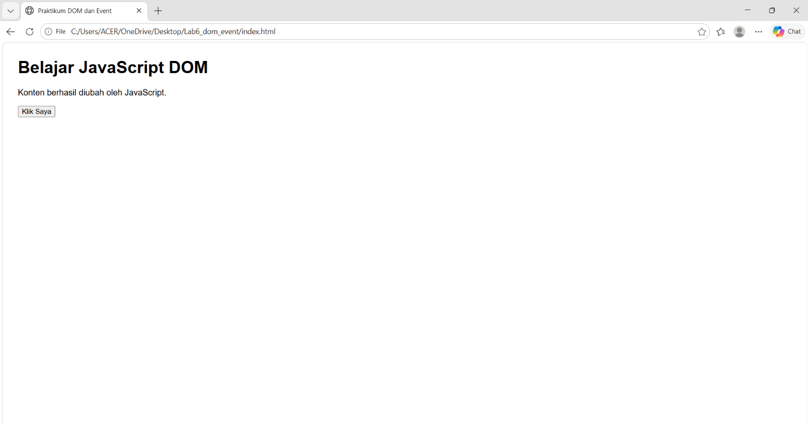
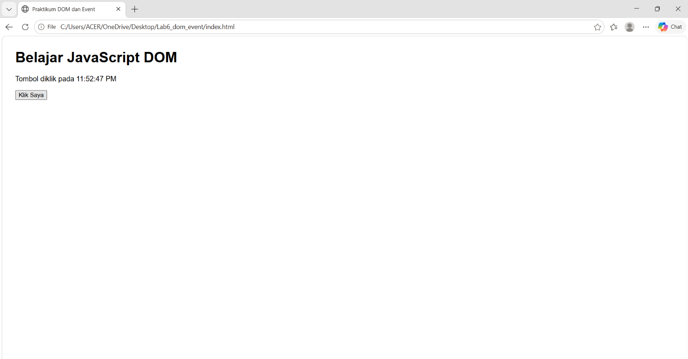
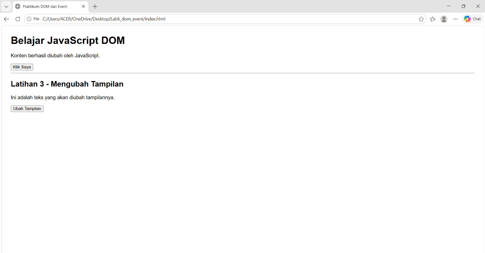
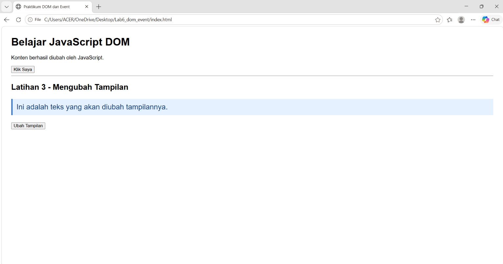
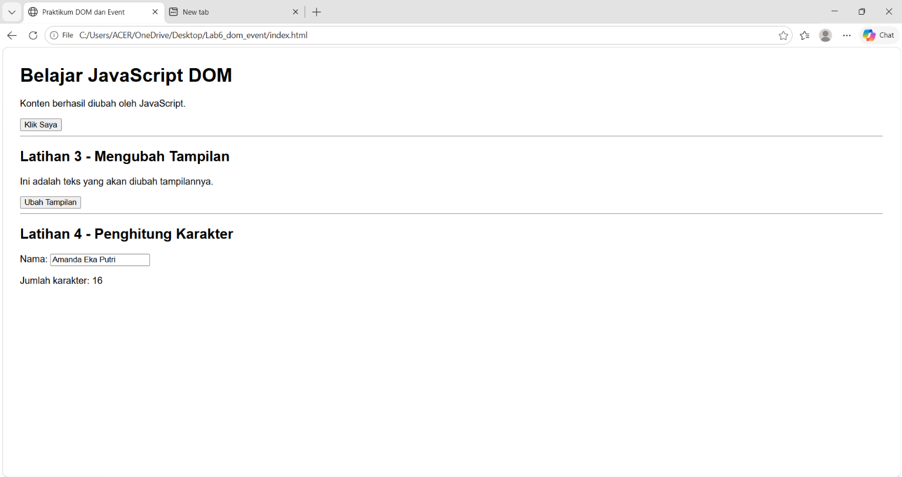
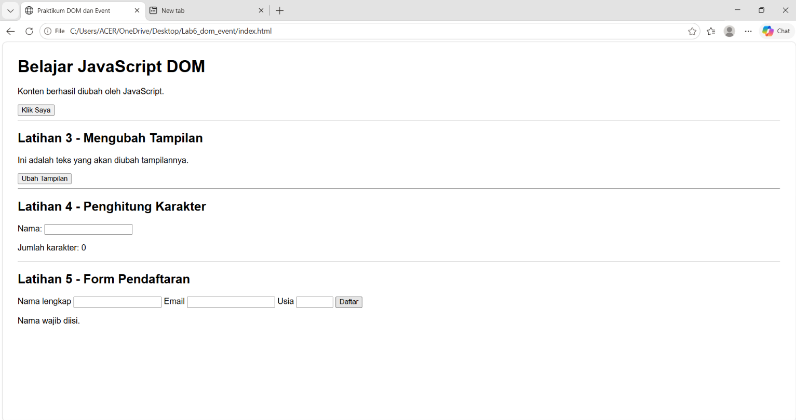
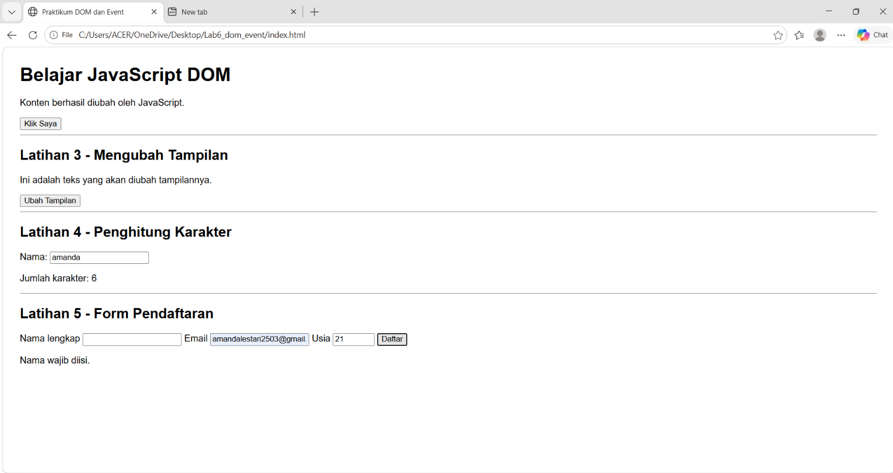
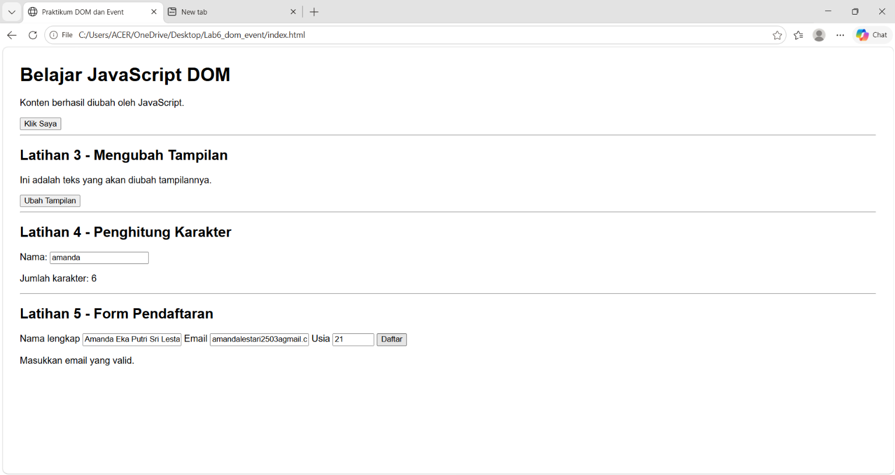
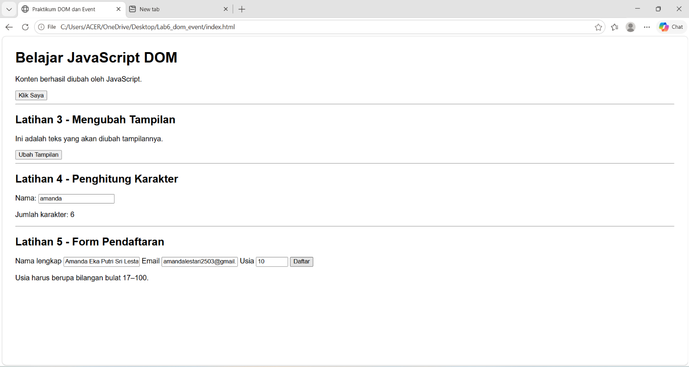
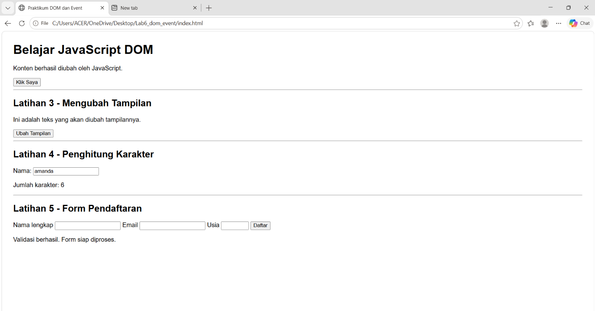
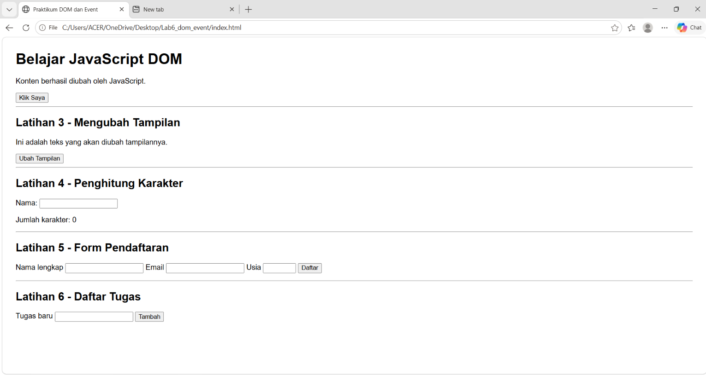
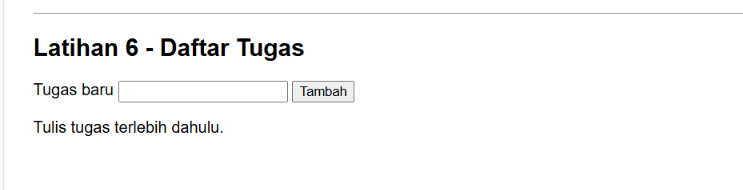
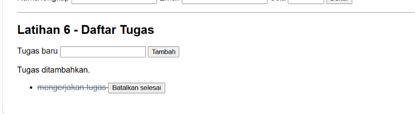
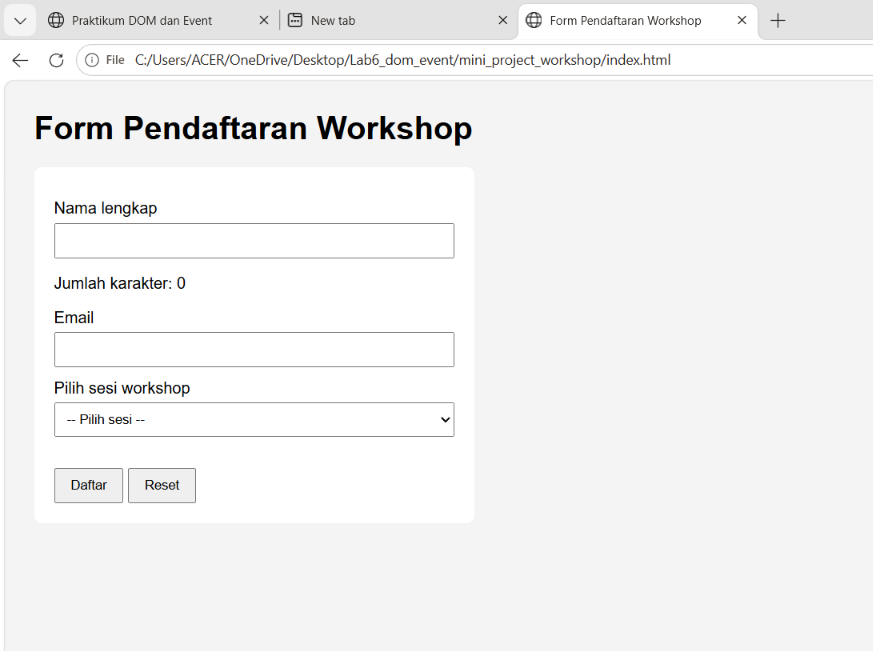
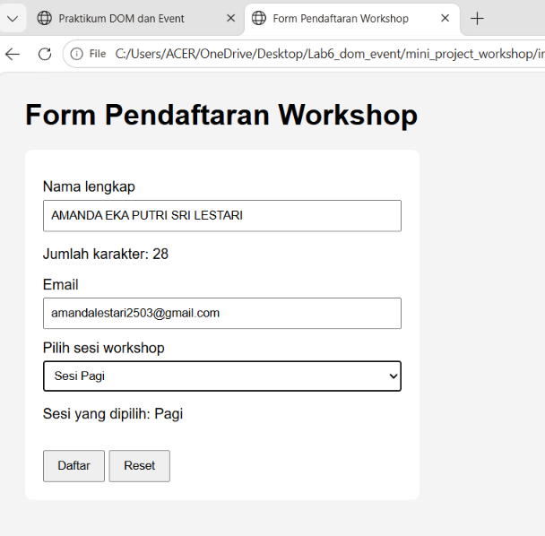
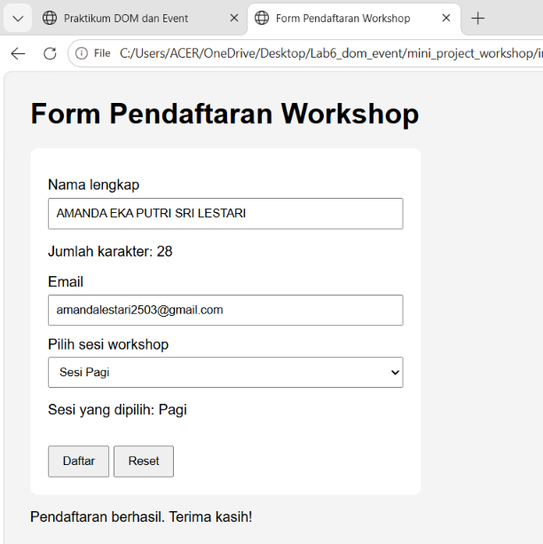
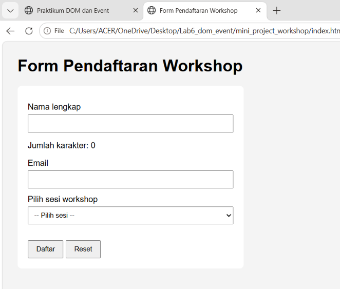
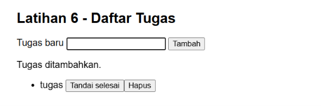
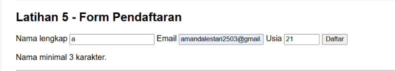
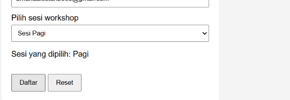
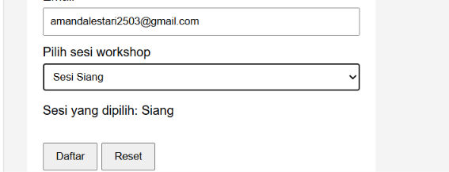
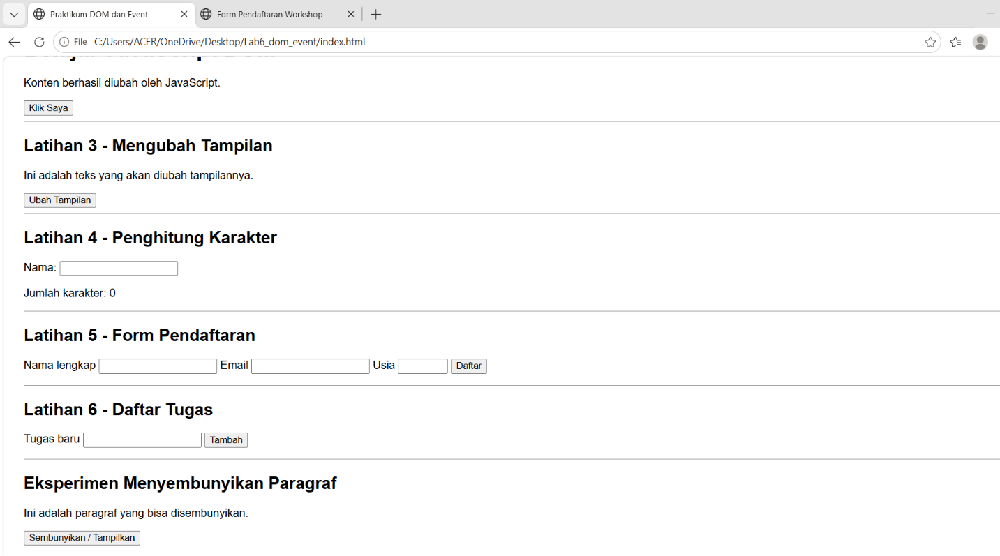
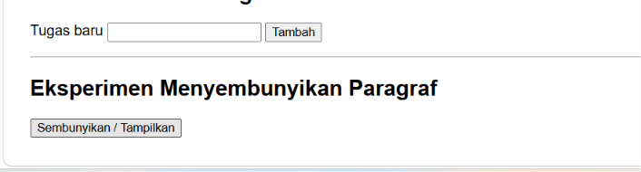
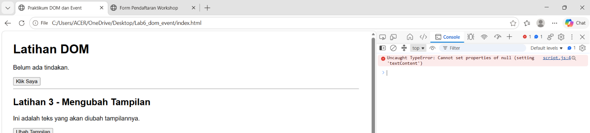